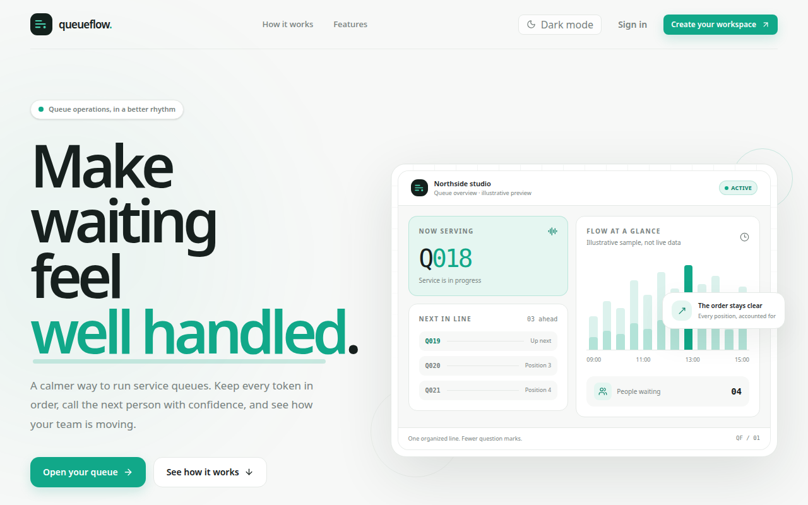
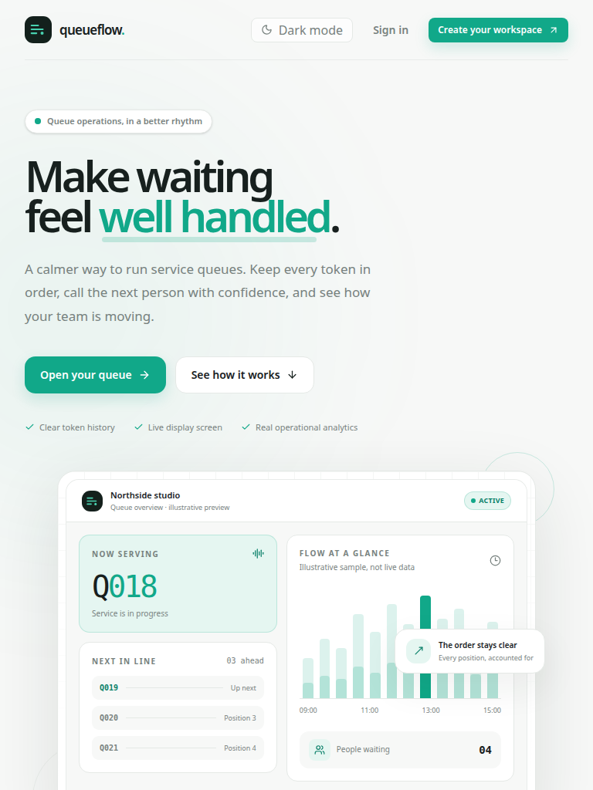
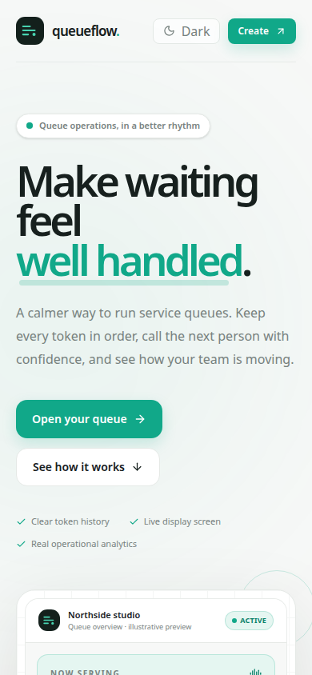
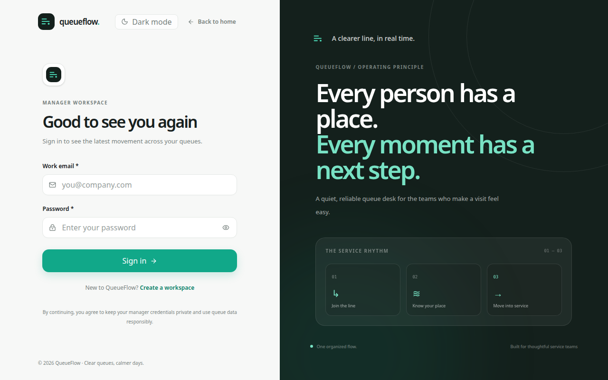
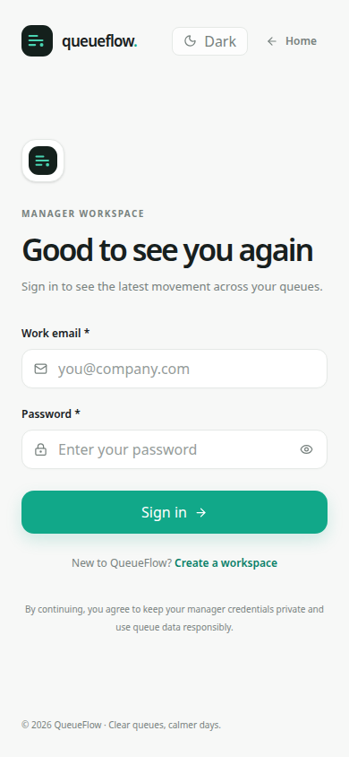

# QueueFlow

QueueFlow is a real-time queue-management workspace for service teams. Managers create queues, add and prioritize visitors, call and complete service, and measure real waiting and service performance. Visitors see a privacy-safe display that stays in sync with the manager desk.

## Screenshots

The labeled Light/Dark control appears in these landing and sign-in headers. Landing captures were taken from the running Preview at desktop (1280 × 800), tablet (768 × 1024) and mobile (390 × 844); sign-in captures are desktop and mobile. The dashboard is omitted so illustrative landing-page metrics cannot be mistaken for live operational data.











## Features

- Manager registration, sign-in/out, seven-day JWT sessions in an HTTP-only cookie, CSRF protection, per-manager ownership and rate-limited authentication.
- Multiple searchable queues with active/paused/closed lifecycle; visitor tokens with per-queue monotonic numbers; concurrent-safe Call Next, cancellation, completion, waiting-list reorder and searchable status history.
- Same-origin REST and Socket.IO in the default Preview. Public screens are read-only and disclose token numbers/status only, not names, phones or manager data.
- Database-derived queue totals, status counts, wait/service durations, daily arrivals/completions/cancellations, waiting-line trend, arrival peaks, per-queue comparisons and recent activity.
- Responsive Next.js App Router UI, accessible forms, persistent themes with a labeled Light/Dark toggle in the public, sign-in/register and manager headers, animated queue transitions and a fine-pointer/reduced-motion-aware custom cursor.

## Stack and structure

| Package            | Responsibility                                                                                                                                    |
| ------------------ | ------------------------------------------------------------------------------------------------------------------------------------------------- |
| `frontend/`        | Next.js App Router, TypeScript, Tailwind, shadcn-style accessible primitives, Framer Motion, Recharts, React Hook Form, Zod and Socket.IO client. |
| `backend/`         | Express REST APIs, Mongoose services/models, bcrypt password hashing, JWT sessions, Socket.IO, seed tooling and integration tests.                |
| `packages/shared/` | UI-safe domain/API types and shared Zod input contracts.                                                                                          |
| `docs/`            | API reference and architecture/deployment decisions.                                                                                              |

In managed Preview and the default unified deployment, a custom Node entry point mounts Express and Socket.IO and passes page rendering to Next.js on one `PORT`. This keeps the browser on relative `/api` and `/socket.io` paths. A separate frontend/backend deployment can set the optional browser-safe API and Socket.IO origins; the server still uses the same REST/business services.

## Requirements

- Node.js 20.9 or newer (Node 22 LTS recommended) and npm 10.
- MongoDB Community Server for local development, or a MongoDB Atlas cluster and a database user. The repository contains **no Atlas URI or account credentials**; use a local `.env` or the host's protected environment settings. QueueFlow never connects to a sample database or seeds records automatically.

## Install and run locally

```bash
npm ci
cp .env.example .env
```

Edit `.env` with a local MongoDB URI or your Atlas URI, then set `JWT_SECRET` to a fresh random value of at least 32 characters. For example:

```bash
openssl rand -base64 48
```

`MONGODB_URI` examples (replace placeholders; never commit real credentials):

```dotenv
MONGODB_URI=mongodb://127.0.0.1:27017/queueflow
# Atlas format: mongodb+srv://<database-user>:<password>@<cluster-host>/queueflow?retryWrites=true&w=majority
```

`COOKIE_SECURE` defaults to `true`, including in HTTPS Preview and deployed environments; this selects the eligible `SameSite=None; Secure` cookie attributes independently of the internal request scheme or `NODE_ENV`. The checked-in `.env.example` selects `false` for a local plain-HTTP run; keep it `false` only on localhost and use `true` on HTTPS. Keep the CORS `FRONTEND_URL` equal to the browser-facing app origin in a split deployment. Do not expose secrets as `NEXT_PUBLIC_*` values.

```bash
npm run dev
```

The site and API use `http://localhost:3000`; the public read-only display is `/display/<publicId>` and the manager pages are `/dashboard`, `/dashboard/queues`, `/dashboard/analytics` and `/dashboard/settings`. Data-dependent APIs return HTTP 503 with setup guidance until MongoDB is reachable; the landing and application shells do not fabricate records.

## Optional development seed

The seed command is explicit, refuses to run when `NODE_ENV=production`, requires a user-chosen password of 10–72 characters, and never runs during server startup. It creates one demo manager if absent, three queues and timestamped example tokens/activity; an existing demo user's password is not replaced.

```bash
DEMO_EMAIL=demo@queueflow.local DEMO_PASSWORD='choose-a-development-only-password' npm run seed
```

Sign in with the supplied `DEMO_EMAIL` and the exact `DEMO_PASSWORD` value you set for that command. Do not use this sample identity or password in production.

## Scripts

| Command                                   | Purpose                                                                                                                                                                        |
| ----------------------------------------- | ------------------------------------------------------------------------------------------------------------------------------------------------------------------------------ |
| `npm run dev`                             | Build shared contracts and run the custom Express/Next development server with reload.                                                                                         |
| `npm run build`                           | Compile shared contracts and backend, then production-build the App Router frontend.                                                                                           |
| `npm start`                               | Start the compiled unified Node application; provide `MONGODB_URI`, `JWT_SECRET`, `PORT` and HTTPS cookie/CORS settings at runtime.                                            |
| `npm run typecheck`                       | Type-check shared contracts, backend and frontend in dependency order.                                                                                                         |
| `npm test`                                | Run pure-domain/UI tests plus HTTP integration tests against an isolated in-memory MongoDB, never the configured Atlas database. First run may download a MongoDB test binary. |
| `npm run lint`                            | Run the configured workspace lint tasks.                                                                                                                                       |
| `npm run format` / `npm run format:check` | Apply/check Prettier.                                                                                                                                                          |
| `npm run seed`                            | Explicitly create the optional development dataset described above.                                                                                                            |

The integration test service binds an ephemeral local test database; it neither reads nor writes `MONGODB_URI`. Production, staging and user-owned Atlas data are not involved.

## API and data documentation

- [REST API reference](docs/API.md)
- [Architecture, data lifecycle, security and deployment](docs/ARCHITECTURE.md)

All successful JSON responses use `{ "success": true, "data": ... }`; failures use `{ "success": false, "error": "..." }`. Every cookie-authenticated write (including registration/login/logout) must send `x-csrf-token` equal to the CSRF cookie value. The API client handles this handshake automatically.

## Deployment

### Unified Node host (recommended first deployment)

Build the repository with `npm ci && npm run build`, then start `npm start` on a Node 20.9+ container/host. Keep one HTTPS origin for pages, REST and Socket.IO. Set `PORT` (default 3000), `MONGODB_URI`, a unique random 32+ character `JWT_SECRET`, `COOKIE_SECURE=true`, `FRONTEND_URL` to the public browser-facing origin and `NODE_ENV=production`. Persist application records in Atlas, not on container disk; the server bootstraps Mongoose indexes after connecting and exposes unauthenticated `GET /api/health` readiness. The build step does not require private database secrets.

### Split frontend (Vercel) and backend (Render or AWS)

Build the Next.js frontend on Vercel and deploy the Express/Next/Socket.IO Node application to Render/AWS. Supply `NEXT_PUBLIC_API_URL=https://<api-host>/api` and, if needed, `NEXT_PUBLIC_SOCKET_URL=https://<api-host>` at **frontend build time**. On the server set `FRONTEND_URL` to the exact HTTPS site origin, `COOKIE_SECURE=true`, Atlas URI and random JWT secret; allow credentialed CORS only from that origin. Use HTTPS for both hosts, keep session cookies host-only/HttpOnly/Secure/SameSite=None, send the double-submit CSRF token, and use a stable domain arrangement that avoids third-party-cookie blocking. Socket.IO needs WebSocket/long-polling support and the same credentialed origin policy. Verify `/api/health`, graceful SIGTERM shutdown and login/cookie delivery in the production browser context.

For each new host or isolated environment, configure the Atlas URI and JWT signing secret in its protected environment settings. Do not commit `.env`, `.env.local` or real credentials; protected project values are not part of the repository or build artifact.
